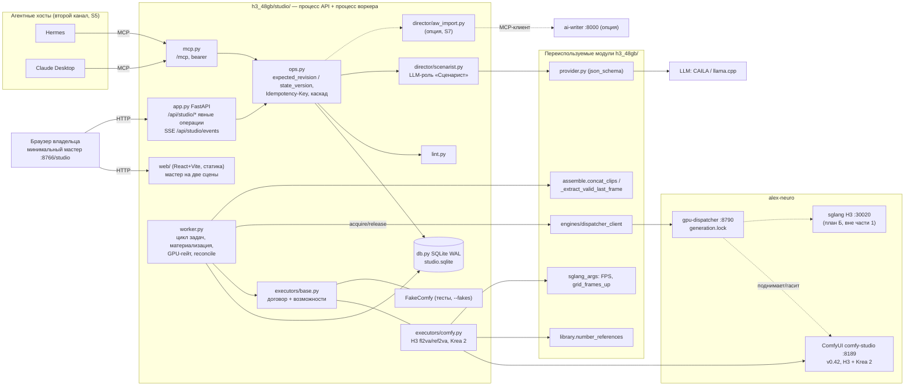
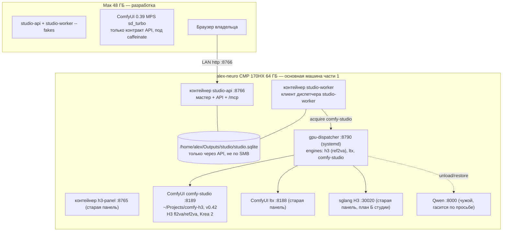
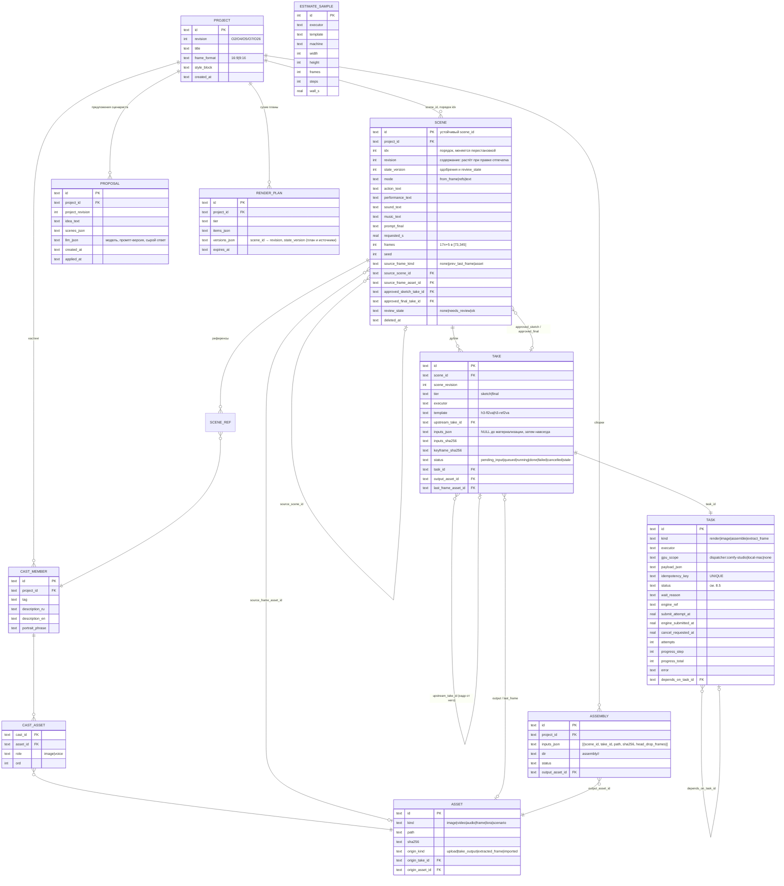
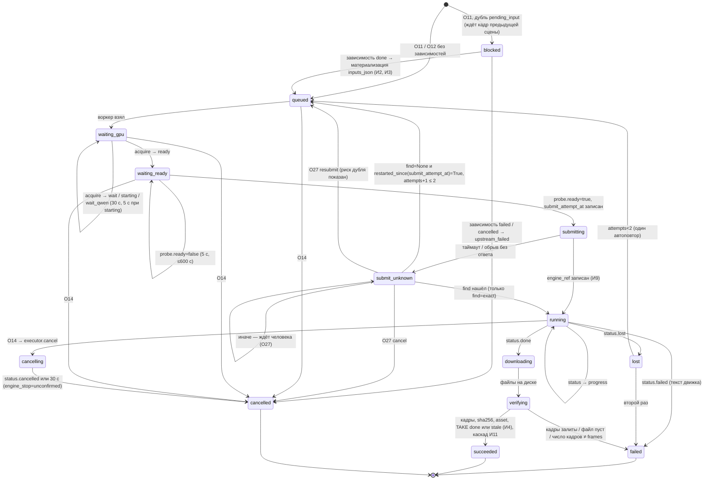
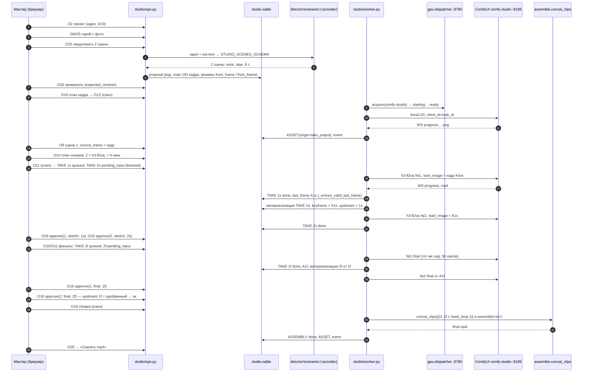
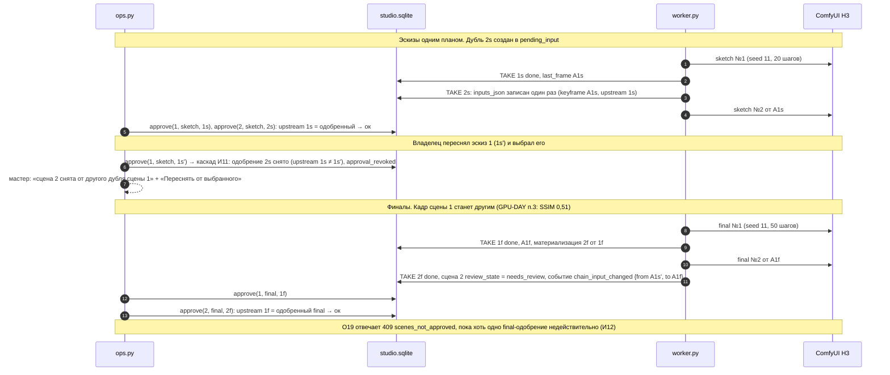

# Студия, часть 1: ядро, исполнитель ComfyUI, минимальный мастер, сценарист — спека

Дата: 2026-10-10, **редакция 2 — 2026-10-20**. Статус: **спека на проверку не автором** (CLAUDE.md:
план против спеки проверяет тот, кто его не писал). Код не написан. Автор редакции 1: Claude Fable 5.1;
редакции 2: Claude Opus 5.5 по заданию владельца (`BRIEF-spec-part1-rev2.md`).

Источники решений, которые здесь не пересматриваются:
- видение `2026-10-09-studio-vision.md` (+§5а) и его ревью `vision-review/{SUMMARY,codex,codex-2-hermes,fable}.md`
  (консенсус: вертикальные срезы, мастер первым, своего чата нет, одно хранилище состояния);
- ландшафт `docs/research/2026-10-09-studio-landscape/README.md` (свой тонкий слой; MCP по образцу ArcReel и comfyui-mcp);
- решения владельца `2026-10-08-panel-wave2-DRAFT.md` §4 (Р1–Р9) и стек `docs/design/2026-10-panel-audit/WAVE2-STACK.md`;
- путь пользователя `2026-10-09-panel-wave2-CJM.md` (П1–П7, пять ставок приняты);
- факты о H3: `docs/h3-modes/{README,MATRIX,DRAFT-VS-FINAL,PROMPT-FORMAT,GAIT-SOUND}.md`;
- **замеры первого дня с GPU** `docs/h3-modes/GPU-DAY-20261020.md` (далее GPU-DAY);
- **ревью спеки** `vision-review/codex-3-spec-part1.md` (далее «Codex-N» — номер находки);
- **решения владельца 20.10** (§17, п. 1–5).

Обозначения: «ч» — человек (владелец), «с» — система. Пути без корня — относительно этого репо.
Пометка **(ставка)** — решение без замера, проверяется в срезе или проверкой §15.

---

## 0. Редакция 2: что изменилось и почему

| # | Изменение | Почему | Находка / источник |
|---|---|---|---|
| Р2-1 | **Основной исполнитель видео H3 — ComfyUI**, sglang — план Б вне части 1 | GPU-DAY п.1: 3 с/20 шагов за 72 с, смена fl2va↔ref2va ≈16 с против ≈150 с у sglang | GPU-DAY п.1; снимает Codex-3 и Codex-7 с критического пути |
| Р2-2 | Krea 2 на alex-neuro — шаблон ComfyUI; Draw Things убран из части 1 (остаётся будущим исполнителем Мака) | gRPC-сервера DT на alex-neuro нет; Krea 2 в ComfyUI 5,4 с на кадр; решение владельца 5 | GPU-DAY п.2; Codex-9 (синхронный DT remote), Codex-14 |
| Р2-3 | В части 1 **один адаптер** — `executors/comfy.py` (H3 fl2va/ref2va, Krea 2); договор §8.1 описывает возможности адаптера, а не общее равенство | лишние адаптеры — инфраструктура раньше пути | Codex-9, Codex-14 |
| Р2-4 | **Минимальный мастер на две сцены** входит в часть 1 и является каналом приёмки; MCP — второй канал над теми же операциями, не на критическом пути | решение владельца 1; «мастер первым» — консенсус ревью видения | Codex-6, Codex-14 |
| Р2-5 | Режиссёр: основной путь — **своя LLM-роль «Сценарист»** (как Scenario mode старой панели); ai-writer — дополнительный путь для сложных сцен, импорт вне критического пути | решение владельца 4 | — |
| Р2-6 | Дубль-намерение и материализация: дубль продолжения создаётся в `pending_input`, его `inputs_json` пишется один раз — когда готов кадр предыдущей сцены; ожидание кадра — `blocked`, не ошибка линта | замороженные входы цепочки не существуют в момент постановки | **Codex-1** |
| Р2-7 | Две версии сцены: `revision` (содержание) и `state_version` (одобрения); одобрение привязано к дублю и к дублю-источнику кадра; каскад пересчитывается при правке, одобрении и завершении дубля; «выбрать» и «одобрить» слиты в одно действие | устаревшие продолжения можно было одобрить и собрать | **Codex-2**, Codex-12 |
| Р2-8 | Переключение вариантов sglang в диспетчере специфицировано (§8.6), но в часть 1 не входит; в часть 1 диспетчер получает один новый EngineSpec `comfy-studio` без вариантов | при ComfyUI-основном вариант меняется внутри одного процесса | **Codex-3** (переоценён: не блокер части 1) |
| Р2-9 | `submit_unknown` без положительной находки не повторяется автоматически; правило «GPU util < 10 %» удалено; единственное автоматическое разрешение без находки — доказанный рестарт процесса исполнителя после попытки постановки | низкая загрузка не доказывает, что задачи нет | **Codex-4**, GPU-DAY п.5 |
| Р2-10 | `assemble.run()` не вызывается; из него выделяется чистая `concat_clips()` над замороженным списком входов, без `Project`, стадий и уборки | `run()` читает и меняет `project.json`, удаляет `keyframes/` | **Codex-5** |
| Р2-11 | `library.build_ref2va` делится на чистую нумерацию над переданными карточками и обёртку с `get_card` | функция читает файловую библиотеку сама | Codex-8 |
| Р2-12 | Контрактные тесты проверяют фактический payload и байты загруженных файлов; сравнение результата — по декодированным кадрам (`framemd5`), мутаций 11 | одинаковый итоговый SHA-256 не доказывает правильных входов | Codex-10 |
| Р2-13 | Добавлены таблицы `proposal`, `render_plan`, `estimate_sample`, `cast_asset`; устойчивый `scene_id`, мягкое удаление сцен; правила роста ревизий | сущности были без схем | Codex-11 |
| Р2-14 | Длительность: запрошенная `requested_s` и фактические `frames`; снап — к ближайшей точке сетки в `[73, 345]` кадров; пример исправлен на 192 кадра | 8 с = 192 кадра (проверено), 15 с = 362 кадра вне границы | Codex-13 (проверено кодом, §6.2) |
| Р2-15 | Лимит картинок-референсов — функция числа кадров в карточке шаблона, по замерам 20.10 | 15 с держит 4 картинки, 5 не проходят уже на 10 с | GPU-DAY п.4 |
| Р2-16 | Срезы перестроены: первым — две сцены через мастер на настоящем ComfyUI; критерий достигается в S4; порт ai-writer, LoRA, sglang, DT, MCP — после | инфраструктура раньше пути | Codex-14 |
| Р2-17 | Числа: 482 теста в переиспользуемых файлах (было «≈380»), всего 2103 `def test_`; инструменты MCP пересчитаны; регрессия старых тестов отделена от доказательств новых инвариантов | — | Codex-15 |
| Р2-18 | Прогресс: ComfyUI — WS `progress` по `prompt_id`; sglang (план Б) — tqdm из лога; `GET /v1/videos` живёт в памяти процесса | замер | GPU-DAY п.5, п.7 |

Отклонённые части находок — в тексте разделов с причиной; сводка — §17.3.

---

## 1. Цель и критерий готовности

**Цель части 1.** Ядро студии и минимальный мастер, с которыми владелец сам, без ssh/curl/правки
файлов, проходит путь «идея → две сцены → первый кадр → эскизы → выбор → финал → сборка → mp4», где
исполнитель подключён по договору (§8), состояние живёт в одной базе, задачи переживают обрывы, а
мастер и любой MCP-хост работают через один и тот же набор явных операций (§7).

**Критерий готовности (один).** Владелец в браузере на Маке открывает мастер студии
`http://alex-neuro:8766/studio` и без подсказок проходит путь выше на **настоящем ComfyUI** alex-neuro
(H3 fl2va/ref2va и Krea 2): две сцены (1 — от кадра Krea 2 или от референса, 2 — продолжение от
последнего кадра 1), эскизы обеих, выбор, финалы обеих, повторное одобрение продолжения, сборка,
скачивание mp4. Проход журналируется (что нажато, сколько ждал, где застрял). Путь закреплён
сквозным тестом (§12.3) на имитациях; тот же контрактный тест исполнителя (§12.2) зелёный на живом
ComfyUI alex-neuro. Тест доказывает, что путь есть; проход владельца — что им можно пользоваться.

Срезы §14 — каждый со своей приёмкой владельцем; критерий достигается в S4, часть сделана после S6.

## 2. Не-цели части 1

| Не делаем | Где это будет |
|---|---|
| Полный мастер (CJM экраны 1–15), темы, «Готовое» как раздел, 3+ сцены в мастере | часть 3; в части 1 — минимальный мастер на две сцены (§4.4) |
| Vision-критик, автопересъёмка | часть 2; сейчас только линтер промпта (§10) |
| MCP Apps (`ui://` виджеты) | после мастера, слой 2 (SUMMARY §«Хосты») |
| Граф цепочек, карточки-DSL узлов, маршрутизация по нескольким машинам | отвергнуто ревью (SUMMARY п.7); адрес исполнителя — строка в `SETTING` |
| Адаптер sglang H3 и переключение вариантов в диспетчере | план Б (§8.6): после части 1 или если проверка §15 п.1 провалится |
| Адаптер Draw Things (local/remote) | после части 1, как исполнитель Мака (решение владельца 5) |
| Импорт сценария ai-writer (`clip_*`, `?format=h3`) | опциональный срез S7 после критерия (решение владельца 4) |
| LoRA: импорт и обучение | после части 1; в схеме зарезервирован только `asset.kind='lora'` |
| Апскейл LTX из студии | после проверки LTX в экземпляре `comfy-studio` (§15 п.10); в части 1 сборка без апскейла |
| Wan, YuE2, клип под трек | волна 3 (Р3) |
| Перенос старых `project.json` в SQLite | не делается (решение владельца 3); старая панель живёт |
| Авторизация и доступ из интернета | до любого мобильного хоста (fable §2б); в части 1 — LAN и bearer на MCP |
| Свой чат | не пишем (SUMMARY п.3) |

---

## 3. Ключевое решение: эволюция в этом репо (strangler), не новый пакет

**Решение: студия растёт в этом репо как пакет `h3_48gb/studio/` рядом с `web.py`, новое
FastAPI-приложение на своём порту, доменные модули переиспользуются через узкие швы, существующие
тесты остаются контрактом.** Ниже — что именно берётся и где шов шире, чем казалось в редакции 1
(всё проверено по коду 20.10).

### 3.1. Что переиспользуется (пути:строки)

| Модуль | Тестов | Что берём и как |
|---|---|---|
| `h3_48gb/engines/ltx.py` (274) | 22 `test_ltx_upscale.py` | `ComfyClient` (`:55`, upload/prompt/history/interrupt), опрос `/history` с `MAX_ODD_HISTORY_POLLS=12` (`:31`), `set_scene_ltx_if_current` (`:252`) как образец «поздний результат не затирает». Обобщается в `studio/executors/comfy.py` (+`queue`, `object_info`, `models`, WS); `upscale_part` переводится на обобщённый клиент, 22 теста без правок |
| `h3_48gb/engines/sglang_args.py` (233) | 18 | **только константы и сетка**: `FPS=24`, `MIN_SECONDS/MAX_SECONDS` (`:18-19`), `grid_frames_up` (`:81`). `parse()` не берётся: требует референс независимо от задачи (`:201-203`), `TASKS=("ref2va",)` (`:32`), отказывает вне сетки вместо снапа (`:170-177`) |
| `h3_48gb/engines/dispatcher_client.py` (77) | 26 `test_gpu_gate.py` | как есть: `acquire/release/status`; новый клиент `studio-worker` |
| `h3_48gb/worker.py` (1308) | 64 | **логика**, не функция: `make_gpu_gate` (`:524`) пишет в файловую очередь (`q.set_running_fields`, `:534`) и спит через `sglang._sleep_unless_cancelled`, который читает файловую очередь (`sglang.py:184`). Студия пишет свой цикл GPU-гейта с теми же параметрами (acquire каждые 30 с, 5 с при `starting`, тепловой порог 80→72 °C) и `_IdleRelease` (`:603`, 15 мин); тесты `test_gpu_gate.py` переносятся как спецификация точными равенствами |
| `h3_48gb/library.py` (331) | 17 + 11 | выделяется чистая `number_references(scene_prompt, cards: dict[tag, card], extra_refs) -> Ref2VAScene` — тело `build_ref2va` (`:272-325`) без `get_card` (`:303`); `build_ref2va` становится обёрткой, читающей карточки из файлов, старые тесты без правок. Студия передаёт карточки из `cast_member`+`cast_asset` в том же словарном виде (`kind`, `description`, `assets`). Голос → `<Audio k>`, картинки → `<Picture k>`; видео-, трек- и LoRA-ресурсы в нумерацию не попадают (видео-референсы и трек — не в части 1; LoRA — не условие, а параметр шаблона) |
| `h3_48gb/assemble.py` (1806) | 68 | выделяется чистая `concat_clips(clips: list[ClipInput], out_path, *, run) -> Path`, где `ClipInput = (path, head_drop_frames, idx)` — тело `_build_video_clip_paths` (`:408`) + `_concat` (`:447`) для режима звука `clips`; без `Project`, без `set_stage_status`, без `_cleanup_*` (`:862-877`). `run()` вызывает её для `audio_mode="clips"`, старые тесты без правок. `_extract_valid_last_frame` (`:593`) берётся как функция над путями. `run()`, `advance_project`, `_submit_next_scene_sglang` студия **не** вызывает (Codex-5: `run()` грузит проект `:757`, меняет его `:864-865`, убирает `keyframes/` `:876`) |
| `h3_48gb/engines/estimate.py` (64) | — | формула «медиана последних 10» переезжает в таблицу `estimate_sample`; ключ расширяется: сейчас `(width, height, frames, steps)` (`:54-57`), в студии `(executor, template, machine, width, height, frames, steps)` — fl2va и ref2va различаются по времени вдвое (GPU-DAY п.1) |
| `h3_48gb/provider.py` (1046) | 92 | OpenAI-совместимый клиент со строгой `json_schema`, SSE против обрыва шлюза; `provider.chat` (`:937`) со своей схемой студии — слой LLM «Сценариста» (§9); `shares_gpu` (`:309`) — для координации с GPU-замком на Маке (§8.4) |
| `h3_48gb/queue.py` (1347) | 98 | не хранилище; таблица `reconcile` (`:1161-1250`) переносится как спецификация состояний задачи (§8.5) и как тесты точным равенством |
| `tools/gpu-dispatcher/dispatcher.py` (619) | 44 | хост остаётся единственным владельцем `generation.lock`. Правка части 1 одна: новый EngineSpec `comfy-studio` в `engine_specs()` (`:65-85`), §8.4. Старые `h3` и `ltx` не меняются |
| `tests/_fake_{comfy,sglang,dispatcher,llama}.py` | — | имитации есть; `_fake_comfy` дописывается шаблонами H3/Krea 2, журналом payload и WS (§12) |

Итого: 482 теста в перечисленных файлах (подсчёт `grep -c "def test_"` 20.10) с инвариантами
(«лиза → маркер → снятие лизы» `worker.py:936-960`; «маркер важнее mp4» `queue.py:1176,1230-1236`;
«поздний апскейл не крепится к новому дублю» `ltx.py:252`; 17n+5-сетка; нумерация `<Picture k>`).
Их зелёный цвет после каждого среза доказывает только, что **старое не сломано**; новые SQLite-пути
доказываются своими тестами с мутациями (§12), а не этими.

### 3.2. Где эволюция кончается

Новое, не наследуемое: модель «сцена с ревизией → неизменяемые дубли» (у `project.py` один
`clip_path` на сцену и `invalidate_scene_chain` стирает его, `project.py:827-898`); очередь и задачи в
SQLite; исполнитель как договор (§8); события как таблица; мастер. `web.py` (6779 строк) не трогается
и не импортируется студией.

### 3.3. Отвергнутые варианты

| Вариант | Почему нет |
|---|---|
| Новый пакет/репо «studio» с нуля | потеря 482 тестов-инвариантов; оценка переписывания ядра DRAFT §2 — 35–55 дней (fable §5) |
| ArcReel или Toonflow как основа | проверено руками 10.10: ArcReel — AGPL, нет продолжения от кадра, нет русского; Toonflow — холст, нет сборки, нет тестов (`eval-toonflow.md`) |
| sglang основным исполнителем видео | GPU-DAY п.1: ComfyUI вдвое быстрее на ref2va и меняет чекпойнт в 9 раз быстрее; sglang — план Б |
| Вызывать `assemble.run()` и `sglang.run_generate()` как есть | оба завязаны на файловую очередь и `project.json` (Codex-5, Codex-7); выделяются чистые части |
| Мак как исполнитель H3 на MLX | Мак заморожен для рендера с 01.10; прогон 1344×768 10.08 закончился kernel panic (CLAUDE.md) |
| Доработка `web.py` на месте | STACK §1: ручной роутинг — источник находок «400 вместо 404»; решение владельца — FastAPI |
| Мастер на f-строках без сборки | выбрасывается в части 3; STACK §2 уже принял React + Vite + TypeScript |
| Prefect / LangGraph для цепочек | codex: преждевременно; одна зависимость `depends_on` |
| SQLAlchemy + Alembic | ~14 таблиц, один пользователь; `sqlite3` + SQL-миграции по `PRAGMA user_version` |
| Redis/ARQ для очереди | STACK §4: GPU один, задач единицы в час |

---

## 4. Архитектура

### 4.1. Компоненты и границы



Границы:
- **Единственный источник состояния — `studio.sqlite`.** Мастер и хосты хранят только вид/разговор.
  ai-writer хранит книгу; студия импортирует его сценарий как ресурс с происхождением, обратной
  синхронизации нет (codex-2 §4).
- **Мастер и MCP — клиенты одних и тех же операций `ops.py`**, своей логики нет ни у одного.
- **Исполнители — чужие процессы.** Студия не загружает модели; движки на alex-neuro поднимает и
  гасит только диспетчер.
- **Воркер — один процесс; одна GPU-задача за раз на GPU-scope**, плюс второй поток для задач
  без GPU (`assemble`, `extract_frame`).

### 4.2. Процессы

| Процесс | Запуск | Что делает | Падение |
|---|---|---|---|
| `studio-api` | `python -m h3_48gb.studio api --port 8766 --outdir $H3_OUTDIR` | FastAPI + статика мастера + MCP (S5) + SSE | перезапуск; воркер не замечает (БД на диске); предложения сценариста живут в БД (`proposal`) |
| `studio-worker` | `python -m h3_48gb.studio worker --outdir $H3_OUTDIR [--fakes]` | `reconcile` → взять задачу с выполненной зависимостью → материализовать входы → GPU-гейт → исполнитель → результат → каскад → событие; один экземпляр под `flock worker.lock` (как `worker.py:105`) | при старте `reconcile` (§8.5); задачу не повторяет вслепую |
| `gpu-dispatcher` (alex-neuro) | systemd, есть | владелец движков и `generation.lock` | `KillMode=process`, движки живут |
| ComfyUI `comfy-studio` | поднимает диспетчер по `acquire("comfy-studio")` | H3 и Krea 2 | задача → `lost` или `submit_unknown` по §8.5 |

На alex-neuro оба процесса студии — два контейнера compose (`studio-api`, `studio-worker`) по
STACK §5, со своими healthcheck; старый `h3-panel` остаётся на :8765 (решение владельца 2). На Маке —
разработка: два процесса в venv с `--fakes`; живой контракт на Маке — ComfyUI MPS с `sd_turbo`
(§12.2), **только под `caffeinate -dimsu`**, логи в `~/Research/TestVideo/_логи/` (CLAUDE.md).

### 4.3. Развёртывание по машинам и портам



Порты: 8765 старая панель, **8766 студия** (решение владельца 2), 8188 ComfyUI старой панели (LTX),
**8189 ComfyUI студии**, 30020 sglang, 8790 диспетчер, 8000 Qwen.

**Почему отдельный экземпляр ComfyUI.** H3 и Krea 2 замерены в `~/Projects/comfy-h3` (v0.42, :8189,
GPU-DAY п.1); рабочий `~/Projects/comfy` (v0.36, :8188) обслуживает LTX старой панели и с H3 не
проверялся. Два экземпляра — два EngineSpec с разными портами; диспетчер держит на карте один из них
(`acquire` гасит другой собственный движок, если он не занят чужим клиентом, `dispatcher.py:472-479`).
Слияние в один экземпляр — после проверки LTX в `comfy-studio` (§15 п.10).

### 4.4. Минимальный мастер (S0–S4)

`h3_48gb/studio/web/` — React + Vite + TypeScript (STACK §2), собирается в статику, отдаётся
`studio-api`; типы запросов генерируются из OpenAPI FastAPI. Состояние — только из API: снимок O3 +
SSE O21 с `Last-Event-ID` (И10). Ни одной операции, которой нет в §7.

Экраны (одна страница-проект с шагами, без навигации по разделам):

| Шаг | Что видит и делает владелец | Операции |
|---|---|---|
| 1. Проект | список проектов, «Новый»: название, формат кадра (16:9 / 9:16), идея текстом | O1, O2 |
| 2. Герой | загрузить фото героя (или пропустить), тег, описание по-русски → EN-описание | O6, O5 |
| 3. Сценарий | «Предложить сцены» → две карточки (действие, игра, звук, режим, длительность); правка текста в карточке; находки линта у поля; «Применить» | O25, O26, O8, O9 |
| 4. Первый кадр | для сцены 1 в режиме `from_frame`: «Сделать кадр» (Krea 2) → картинка → «Взять в сцену 1»; или режим `refs` с фото героя | O12 (план + подтверждение), O8 |
| 5. Эскизы | «Снять эскизы» → план (минуты GPU, смены чекпойнта, находки) → «Подтвердить»; прогресс по шагам, ожидание карты с причиной («Qwen держит карту» + кнопка «Освободить») | O10, O11, O13, O23, O14 |
| 6. Выбор | дубли сцены с `<video controls>`, кадры 0/2/4/8 с, «Выбрать»; конфликт цепочки показан словами и кнопкой «Переснять сцену 2 от выбранного» | O18, O16, O10/O11 |
| 7. Финал | «Снять финалы» → план → подтверждение; после финала 1 сцена 2 помечена «проверьте: кадр изменился» до одобрения | O10, O11, O16 |
| 8. Сборка | «Собрать» (отказ с перечнем неодобренных сцен) → «Скачать mp4» | O19, O20 |

Плюс: «Повторить» у упавшей задачи (O15) и «Разобраться» у `submit_unknown` (§8.5) с двумя кнопками
«Поставить заново» / «Отменить». Проверка — прохождением владельца (критерий §1) и
Playwright-сценарием в S4 на имитациях; скриншоты 1440/390 px — дополнительно, не вместо прохода.

---

## 5. Стек

| Слой | Выбор | Версия | Почему | Отвергнуто |
|---|---|---|---|---|
| Язык | Python | 3.12 | весь домен уже на нём | — |
| HTTP API | FastAPI + Pydantic 2 + uvicorn | `fastapi>=0.143`, `pydantic>=2.9`, `uvicorn>=0.30` (как в ai-writer) | STACK §1: модели запросов, единый обработчик ошибок, OpenAPI → типы мастера и MCP | stdlib `http.server` |
| Мастер | React + Vite + TypeScript | версии фиксируются в `web/package.json` в S0 | STACK §2; часть 3 наращивает тот же код | f-строки без сборки (§3.3) |
| Хранилище | SQLite, `sqlite3` stdlib, WAL, `busy_timeout=5000` | ≥3.35 (`RETURNING`) | STACK §3 | Postgres, SQLAlchemy |
| Миграции | `studio/migrations/NNN.sql`, `PRAGMA user_version` | — | читается глазами; 001 — только таблицы пути S0–S4 | Alembic |
| Бэкап | `sqlite3.Connection.backup()` раз в час, 7 копий | — | копия файла при WAL несогласованна | `cp` |
| Очередь | таблица `task` + `flock worker.lock` | — | STACK §4 | Redis/ARQ |
| События | таблица `event` (seq) → SSE `Last-Event-ID` | — | один журнал для мастера, MCP, отчёта | опрос |
| HTTP к исполнителю | `urllib` (синхронно, как `ltx.py`) | stdlib | один поток на GPU-задачу | httpx |
| Прогресс ComfyUI | `websockets`: `ws://…/ws?clientId=<task_id>`, `progress{value,max,prompt_id}` | `websockets>=12` | GPU-DAY п.7: привязка по `prompt_id` надёжна | только опрос |
| MCP (S5) | `mcp` (FastMCP, streamable HTTP, в процессе API) | `mcp>=2.3` | тот же паттерн, что ai-writer | отдельный контейнер |
| LLM | `provider.py` | — | Р1 | PydanticAI |
| Медиа | ffmpeg/ffprobe (`assemble.concat_clips`, `framemd5` в тестах) | как в образе | уже есть | — |
| Хеши | `hashlib.sha256` файлов и канонического JSON | stdlib | неизменяемые дубли | — |
| Тесты | pytest ≥8; Playwright для мастера (S4, на имитациях) | — | CLAUDE.md: тест виден красным | — |

---

## 6. Модель данных (SQLite)



Таблицы `SCENE_REF` (scene_id, cast_id, ord, role), `EVENT` (seq, ts, kind, project_id, scene_id,
task_id, payload_json), `SETTING` (key, value), `OP_LOG` (idempotency_key, request_sha256,
response_json, http_status, created_at), `WORKFLOW_TEMPLATE` (id, executor, name, path, sha256,
bindings_json, requires_json, verified_on) — как в редакции 1. `requires_json.limits` теперь несёт
`frames: [min, max]` и `ref_images_by_frames: [[max_frames, max_images], …]` (§10 L7b).

### 6.1. Инварианты (каждый — тест точным равенством, каждый показан красным)

| # | Инвариант | Где держится |
|---|---|---|
| И1 | `scene.revision` растёт на 1 при изменении любого поля отпечатка: `mode, action_text, performance_text, sound_text, music_text, frames, seed, source_frame_kind, source_scene_id, source_frame_asset_id, SCENE_REF`. Одобрение, `review_state`, `title` проекта ревизию сцены не трогают | `ops.update_scene` в одной транзакции |
| И2 | `take.inputs_json` пишется **ровно один раз**: из `NULL` в значение при материализации; любое другое `UPDATE` поля — `RAISE(ABORT)` триггером | миграция 001 |
| И3 | Дубль материализуется только когда все его входы существуют: для продолжения — `upstream_take.status='done'` и `last_frame_asset_id` задан; `keyframe_sha256 = sha256(upstream.last_frame)` | `worker._materialize` в `BEGIN IMMEDIATE` |
| И4 | Поздний результат: `take.scene_revision < scene.revision` → дубль `stale`, одобрить нельзя (409 `take_stale`), событие `take_stale` | `worker._finish_take`, `ops.approve` |
| И5 | `task.idempotency_key` UNIQUE; повтор с тем же ключом и телом → та же задача (200) | `ops.enqueue` |
| И6 | Постановка задач и дублей плана — одна транзакция | `ops.render` |
| И7 | Ресурс неизменяем; новая версия = новый ресурс с `origin_asset_id` | `ops.import_asset` |
| И8 | `event.seq` монотонный, в той же транзакции, что изменение | все `ops.*` |
| И9 | `task.engine_ref` пишется сразу после ответа исполнителя и до первого опроса; `submit_attempt_at` — до отправки | воркер |
| И10 | Снимок O3 несёт `last_seq`; клиент подписывается с `Last-Event-ID=last_seq` | `app.py` |
| И11 | **Одобрение действительно**, только если: `take.scene_id = scene.id`, `take.scene_revision = scene.revision`, `take.status='done'`, и для продолжения `take.upstream_take_id = source_scene.approved_<tier>_take_id`. Недействительное одобрение снимается (`approved_*=NULL`, `review_state='needs_review'`, `state_version+1`, событие `approval_revoked{reason}`) | `ops.recompute_cascade` — вызывается из O7, O8, O16 и `worker._finish_take` в той же транзакции |
| И12 | Сборка ставится только при действительных И11 одобрениях `final` всех неудалённых сцен; список входов замораживается в `assembly.inputs_json` при постановке; каталог сборки уникален | `ops.assemble` |

### 6.2. Длительность и снимок входов дубля

**Длительность (Codex-13, проверено кодом).** Сетка `frames = 17n+5` (`sglang_args.py:81`), FPS 24.
8 с = 192 кадра — уже на сетке; пример редакции 1 «197» был ошибкой. 15 с = 360 → `grid_frames_up`
даёт 362 = 15,083 с, это выше `MAX_SECONDS`, и старый `parse()` такой длительности не примет
(`:166`, `:170-177`); 3 с = 72 → 73 = 3,042 с. Правило студии: `requested_s` хранится как ввёл
человек/сценарист; `frames` = ближайшая точка сетки к `requested_s × 24`, при равенстве — вверх,
затем зажим в `[73, 345]` (3,042–14,375 с). Фактическая длительность = `frames / 24` — её показывают
мастер и план. Граница 345 — для обоих исполнителей, пока §15 п.1 не покажет, что ComfyUI держит больше.

Канонический JSON (ключи отсортированы, `ensure_ascii=False`), `inputs_sha256` — хеш этой строки:

```json
{"executor":"comfy","template":{"id":"h3-fl2va","sha256":"…"},"tier":"sketch","steps":20,"seed":12,
 "prompt":"<prompt_final дословно>","requested_s":8.0,"frames":192,"canvas":[896,512],
 "keyframes":[{"position":0,"asset_id":"a_…","sha256":"…","upstream_take_id":"t_…"}],
 "refs":[{"ord":1,"role":"person","asset_id":"a_…","sha256":"…","label":"<Picture 1>"}],
 "audio":[],"scene_revision":3,"engine_version":"ComfyUI v0.42.0 b1a247c9"}
```

Два дубля с одинаковым `inputs_sha256` — «пересъёмка с тем же сидом»: разрешена, мастер предупреждает.

---

## 7. API явных операций

Все под `/api/studio`. Тело ошибки — `{"error":{"code","message","detail"}}` (DRAFT (а)), свой
обработчик `RequestValidationError` → 400 `args_invalid`; проверки «проект есть» — зависимостями до
разбора тела. Одни и те же операции вызывают мастер (§4.4) и MCP (§11).

Версии и ключи:
- **`expected_revision`** — для операций над содержимым: проекта (O4, O5, O7, O26) и сцены (O8).
  Не совпало → 409 `revision_conflict`, `detail.current` — снимок.
- **`expected_state_version`** — для одобрения (O16). Не совпало → 409 `state_conflict`.
- **Правила роста.** `project.revision` +1: O4, O5, O7, O26 (структура и состав сцен). Сцена:
  `revision` +1 по И1; `state_version` +1 при одобрении, снятии одобрения, смене `review_state`.
  O8 и O16 проект не трогают — поэтому правка одной сцены не делает устаревшим план другой.
- **План (O10)** запоминает `revision` и `state_version` каждой сцены плана и каждой сцены-источника
  кадра; O11 сверяет их, не `project.revision`; расхождение → 409 `plan_stale` с перечнем.
- **`Idempotency-Key`** (заголовок, обязателен для O11, O12, O15, O19, O24): `OP_LOG` хранит sha256 тела
  и ответ 24 ч; тот же ключ + другое тело → 422 `idempotency_mismatch`. Мастер генерирует `uuid4` на
  нажатие; MCP — из `(tool, plan_id)`.

| # | Операция | Метод и путь | Вход | Выход |
|---|---|---|---|---|
| O1 | Список проектов | `GET /projects` | — | `[{id,title,revision,scenes_done/total}]` |
| O2 | Создать проект | `POST /projects` | `title, frame_format, idea_text?` | проект (201) |
| O3 | Снимок | `GET /projects/{id}` | — | проект + сцены (с `revision`, `state_version`, действительностью одобрений, конфликтами цепочки) + кастинг + дубли + задачи + `last_seq` |
| O4 | Изменить проект | `PATCH /projects/{id}` | `expected_revision, title?` (`frame_format` после первого done-дубля — 409 `format_locked`) | проект |
| O5 | Кастинг | `POST /projects/{id}/cast` | `tag, description_ru, assets[{asset_id, role}], expected_revision` | cast_member с `description_en` |
| O6 | Импорт ресурса | `POST /assets` (multipart) | файл, `kind?` | asset |
| O7 | Заменить набор сцен | `PUT /projects/{id}/scenes` | `expected_revision, scenes[{scene_id?, mode, action_text, performance_text, sound_text, music_text?, requested_s, seed?, source_frame{kind, scene_id?, asset_id?}, refs[tag]}]` — порядок массива задаёт `idx` | сцены + `diff{added, unchanged, changed, moved, deleted}` |
| O8 | Изменить сцену | `PATCH /scenes/{id}` | `expected_revision` + поля (в т.ч. `source_frame{kind:"asset", asset_id}` — подключение кадра) | сцена + `cascade[scene_id]` |
| O9 | Линт | `POST /projects/{id}/lint` | `scene_ids?` | находки по сценам |
| O10 | План (сухой) | `POST /projects/{id}/plan` | `kind: render\|image, scene_ids, tier` или `prompt, size` для image | `plan_id, items[{scene_id, template, depends_on_scene?, estimate_s}], total_s, checkpoint_switches, lint, blocked[]` (TTL 10 мин) |
| O11 | Рендер по плану | `POST /projects/{id}/render` + ключ | `plan_id` | `tasks[{task_id, take_id, scene_id, status}]` — дубли продолжений в `pending_input` |
| O12 | Кадр по плану | `POST /projects/{id}/image` + ключ | `plan_id` | `task_id`; `asset_id` — в событии и O13 |
| O13 | Статус задачи | `GET /tasks/{id}` | — | task с `progress_step/total`, `wait_reason`, `log_tail` |
| O14 | Отмена | `POST /tasks/{id}/cancel` | `reason` | task (`cancel_requested_at`; см. §8.5 «логическая и фактическая отмена») |
| O15 | Повтор | `POST /tasks/{id}/retry` + ключ | — | новая задача и новый дубль с тем же намерением; входы продолжения материализуются заново |
| O16 | **Выбрать дубль** (= одобрить для tier) | `POST /scenes/{id}/approve` | `tier, take_id, expected_state_version` | сцена + `cascade`; 409 `take_stale` (И4), 409 `chain_mismatch` с `{upstream_take_id, approved_upstream}` (И11) |
| O17 | Снять выбор | `POST /scenes/{id}/unapprove` | `tier, expected_state_version` | сцена + `cascade` |
| O18 | Дубли сцены | `GET /scenes/{id}/takes` | — | `[{take, asset_url, frames_urls[0,2,4,8 с], upstream_take_id, valid_for_approval, reason?}]` |
| O19 | Сборка | `POST /projects/{id}/assemble` + ключ | — | task; 409 `scenes_not_approved` с `missing[{scene_id, idx, reason}]` |
| O20 | Результат | `GET /projects/{id}/result` | — | `asset_url, duration, resolution, bytes, inputs`; файл удалён → 410 |
| O21 | События | `GET /events?after=<seq>` (SSE) | `Last-Event-ID` | `id: seq`, `event: kind`, `data` |
| O22 | Исполнители | `GET /executors` | — | `[{name, address, alive, ready, capabilities, detail}]` |
| O23 | GPU | `GET /gpu`; `POST /gpu/release`; `POST /gpu/qwen/unload` | — | состояние диспетчера; выгрузка Qwen — через ручку диспетчера `/qwen/unload` (`dispatcher.py:590`) |
| O24 | Импорт ai-writer (S7) | `POST /projects/{id}/import/ai-writer` + ключ | `clip_id` или файл `.h3.json`, `expected_revision` | как O7 + asset(kind=scenario) |
| O25 | Сценарист: предложить | `POST /projects/{id}/director/propose` | `idea_text, scenes_count=2` | `proposal_id, scenes[]` — сохраняется в `proposal`, не применяется |
| O26 | Применить предложение | `POST /projects/{id}/director/apply` | `proposal_id, expected_revision` | как O7 |
| O27 | Разрешить `submit_unknown` | `POST /tasks/{id}/resolve` | `action: resubmit\|cancel` | task |

**Сопоставление сцен в O7 (Codex-11).** Идентичность — `scene_id`. Сцена без `scene_id` — новая.
Сцена с `scene_id` и тем же отпечатком сохраняет `revision` и дубли, даже если сменился `idx`
(`moved`). Отсутствующая в массиве — `deleted_at` (дубли и ресурсы остаются, сцена не видна плану и
сборке). Если перестановка меняет, от какой сцены идёт `prev_last_frame`, у продолжения меняется
`source_scene_id` → это правка отпечатка (И1), `changed`, каскад И11.

Производные состояния сцены для планировщика: `ready` — все входы есть; `blocked` — кадр
предыдущей сцены ещё не существует, но в этом же плане есть задача, которая его даст (дубль
создаётся в `pending_input`); `invalid` — линт `error` или источник кадра не будет получен ни этим
планом, ни одобренным дублем.

---

## 8. Договор исполнителя

### 8.1. Протокол (`h3_48gb/studio/executors/base.py`)

```python
class Capabilities(TypedDict):
    find: Literal["exact", "none"]          # можно ли найти нашу задачу без engine_ref
    restart_evidence: bool                  # может ли сказать, что процесс перезапущен после момента t
    progress: bool                          # (шаг, всего) во время работы
    cancel: Literal["hard", "soft", "none"] # hard — останавливает вычисление; soft — только убирает результат
    async_submit: bool                      # submit возвращает ref быстро, работа идёт отдельно

class Probe(TypedDict):
    alive: bool
    ready: bool            # шаблон/модели spec доступны и чужих задач нет
    detail: str

class EngineStatus(TypedDict):
    state: Literal["queued", "running", "done", "failed", "cancelled", "lost"]
    progress: tuple[int, int] | None
    error: str | None

class Executor(Protocol):
    name: str
    capabilities: Capabilities
    def gpu_scope(self, spec: TaskSpec) -> str: ...
    def probe(self, spec: TaskSpec) -> Probe: ...           # Codex-9: readiness зависит от spec
    def estimate_s(self, spec: TaskSpec) -> float: ...
    def submit(self, spec: TaskSpec) -> str: ...            # engine_ref; spec.task_id передаётся движку
    def find(self, spec: TaskSpec) -> str | None: ...       # только при capabilities.find == "exact"
    def restarted_since(self, t: float) -> bool | None: ... # только при restart_evidence
    def status(self, ref: str) -> EngineStatus: ...
    def result(self, ref: str, dest: Path) -> list[Path]: ...
    def cancel(self, ref: str) -> None: ...
```

`TaskSpec` — Pydantic-модель из материализованного `inputs_json` плюс `task_id`, `dest_dir`.
Исполнитель не читает БД и не знает про сцены.

**Контрактный тест проверяет каждую заявленную возможность и только её** (Codex-9): `find` — если
`exact`; `progress` монотонен — если `True`; после `cancel` при `hard` статус `cancelled` и движок
свободен, при `soft` — результат не забирается. Адаптер с `find="none"` обязан проходить сценарий
`submit_unknown → ручное разрешение` (§8.5).

Readiness ≠ liveness: `alive=True, ready=False` → `waiting_ready` с `wait_reason` из `detail`, опрос
каждые 5 с до 600 с (`start_timeout` ComfyUI в диспетчере, `dispatcher.py:83`), потом `failed`.

### 8.2. Адаптер ComfyUI (`executors/comfy.py`) — единственный в части 1

| Пункт | Как |
|---|---|
| Адрес (`SETTING`) | `comfy.url` = `http://127.0.0.1:8189`; `comfy.output_dir` = `/home/alex/Outputs/comfy-h3`; `comfy.scope` = `dispatcher:comfy-studio` (на Маке `local-mac`) |
| Возможности | `find=exact`, `restart_evidence=True`, `progress=True`, `cancel=hard`, `async_submit=True` |
| `probe(spec)` | alive: `GET /system_stats`; ready: `GET /object_info` содержит `requires_json.class_types` шаблона spec, `GET /models/<folder>` содержит `requires_json.models`, `GET /queue` без чужих `running` |
| `submit` | `POST /upload/image` входов (имя `<task_id>-<n>.<ext>`, `overwrite=true`) → граф из `WORKFLOW_TEMPLATE` + `bindings_json` → `POST /prompt {prompt, client_id: task_id, extra_data: {studio_task_id}}`, `filename_prefix = studio/<task_id>/f` → `prompt_id` |
| `find(spec)` | 1) `GET /queue` и `GET /history` — запись с `extra_data.studio_task_id == task_id`; 2) иначе файлы в `output_dir/studio/<task_id>/` → ref `file:<task_id>` (готово); 3) иначе `None` |
| `restarted_since(t)` | время старта процесса движка из `dispatcher /status → own["comfy-studio"].started_at` (поле есть, `dispatcher.py:390-393`) `> t`, или записи движка нет / процесс не жив (тогда очередь ComfyUI, живущая в памяти, потеряна) |
| `status` | WS `/ws?clientId=<task_id>`: `progress {value, max, prompt_id}` → `(шаг, всего)` по нашему `prompt_id`; `executing node=null` → done (GPU-DAY п.7). Откат — `GET /history/<id>` с `MAX_ODD_HISTORY_POLLS=12` (`ltx.py:31`) |
| `result` | готовый mp4 узла сохранения или PNG (Krea 2) из `output_dir/studio/<task_id>/` |
| `cancel` | `POST /interrupt`, если выполняется наш `prompt_id`; `POST /queue {"delete":[prompt_id]}`, если ждёт |
| `estimate_s` | `estimate_sample` по `(executor, template, machine, canvas, frames, steps)`; до истории — `requires_json.estimate_s` |

Шаблоны (`WORKFLOW_TEMPLATE`), источник графа — `h3-bench/gpu_day_comfy.py` и `gpu_day_krea.py`
(ветка `probe/gpu-day-20261020`, коммит 403d840) по официальным `video_minimax_h3_i2v` / `_r2v` и
шаблону Krea 2:

| Шаблон | Узлы (ядро) | Привязки | Проверен | Лимиты |
|---|---|---|---|---|
| `h3-fl2va` | MiniMaxH3ImageToVideo, BasicScheduler simple, res_multistep, SamplerCustomAdvanced | prompt, seed, steps, length=`frames`, start_image, width/height | 3 с/20 шагов, 896×512, 88,5/72 с (GPU-DAY п.1) | frames [73, 345] (ставка до §15 п.1) |
| `h3-ref2va` | MiniMaxH3ReferenceToVideo, те же | prompt (с `subject_definitions`), seed, steps, length, ref_images[1..k] | 3 с/20 шагов, одна картинка | `ref_images_by_frames` §10 L7b |
| `krea2-t2i` | Krea 2 Turbo, 8 шагов euler/simple, cfg 1 | prompt, seed, width/height | 1344×768, 5,3–5,6 с, 18 ГБ (GPU-DAY п.2) | стороны кратны 64 |
| `sdturbo-contract` | sd_turbo, 1 шаг 512×288 | prompt, seed | Мак, только контракт API | — |

`verified_on` у H3-шаблонов ставится после §15 п.1 (8 с/50 шагов) и п.8 (контракт), не раньше.

Старый `ltx.upscale_part` переводится на обобщённый `ComfyClient`: 22 теста `test_ltx_upscale.py`
остаются зелёными без правок.

### 8.3. Голова продолжения при сборке

У sglang продолжение повторяет кадр-источник в кадре 0, сборка срезает 1 кадр
(`SGLANG_OVERLAP_FRAMES = 1`, `assemble.py:184`). Для `h3-fl2va` в ComfyUI GPU-DAY п.1 видел глазами
«начинается ровно с кадра Krea», числом не проверено. До проверки §15 п.3 `head_drop_frames = 1`
для `from_frame`-дублей с `upstream_take_id` (ставка), 0 для остальных; значение пишется в
`inputs_json` дубля при материализации и в `assembly.inputs_json` — сборка его не выводит.

### 8.4. Общий GPU-lock

Один GPU-scope на машину, задачи одного scope строго последовательны.

| Scope | Машина | Кто держит замок | Как берётся |
|---|---|---|---|
| `dispatcher:comfy-studio` | alex-neuro | диспетчер (`generation.lock`) | `acquire("comfy-studio")`. **Правка диспетчера части 1:** новый EngineSpec `comfy-studio` — `~/Projects/comfy-h3/.venv/bin/python main.py --port 8189 --output-directory /home/alex/Outputs/comfy-h3 --listen 127.0.0.1`, `ready_url=:8189/system_stats`, `markers=("main.py","--port 8189")`, `start_timeout=600`. Порт отличается от `ltx` и `h3`, поэтому проверка «чужой на порту» (`:469`) срабатывает только на настоящего чужака |
| `local-mac` | Мак | `studio-worker` (`flock <outdir>/gpu-mac.lock`) | ComfyUI MPS контракт; `studio-api` берёт тот же flock на вызов LLM, если `provider.shares_gpu(cfg)` истинно (`provider.py:309`) — с таймаутом 5 с и ответом 409 `gpu_busy` «сценарист ждёт карту», а не ожиданием в запросе (Codex-14) |
| `none` | любая | — | `assemble`, `extract_frame` — второй поток воркера |

На alex-neuro LLM сценариста по умолчанию CAILA (вне карты). Если в настройках выбран локальный Qwen,
он чужой процесс для диспетчера: `acquire` отвечает `wait_qwen`, мастер показывает «Qwen держит
карту» и кнопку O23 «Освободить» (Codex-12).

Порядок очереди: `priority DESC, created_at ASC`, внутри проекта — группировка по шаблону там, где
`depends_on` позволяет. Смена чекпойнта fl2va↔ref2va в ComfyUI ≈16 с (GPU-DAY п.1); смена Krea 2 ↔ H3
внутри процесса не замерена (§15 п.4) — план O10 показывает её как «≈ ? с» до замера.

Воркер после задачи не освобождает движок: свой аналог `_IdleRelease` (15 мин простоя).

### 8.5. Жизненный цикл задачи и дубля



**`submit_unknown` (Codex-4, принято).** Автоматический повтор без положительной находки разрешён в
одном случае: движок доказуемо перезапущен после попытки постановки (`restarted_since`), а `find` не
нашёл ни записи, ни файлов — задача не могла выжить в процессе, которого больше нет. Во всех
остальных случаях задача ждёт человека: мастер показывает «Не знаю, принял ли ComfyUI задачу» и две
кнопки (O27). Правило «GPU util < 10 % 60 с» удалено: низкая загрузка совместима с задачей, которая
ждёт в очереди, качает входы или уже завершилась.

**Логическая и фактическая отмена (Codex-9).** O14 пишет `cancel_requested_at` — это логическая
отмена: результат такой задачи никогда не крепится к дублю, даже если придёт. Фактическая —
`executor.cancel` у `running`; без подтверждения за 30 с задача `cancelled` с
`engine_stop=unconfirmed`, и следующая GPU-задача ждёт, пока `probe.ready` (очередь движка пуста).
Отмена в `submit_unknown` — логическая; если `find` позже найдёт задачу, воркер вызовет `cancel`.

Таблица `reconcile` при старте воркера (перенос `queue.py:1161-1250`, тесты точным равенством):

| `status` в БД | `engine_ref` | Действие |
|---|---|---|
| `running` / `cancelling` | есть | продолжить опрос / отмену |
| `submitting` | нет | `submit_unknown` → один вызов `find` и `restarted_since` по правилу выше |
| `submit_unknown` | нет | то же; без находки остаётся `submit_unknown` (не теряется после падения воркера) |
| `downloading` / `verifying` | есть | повторить скачивание/проверку |
| `waiting_gpu` / `waiting_ready` | нет | `queued` |
| `blocked` | — | проверить зависимость: `done` → материализовать; `failed/cancelled` → `cancelled` |
| любой с `cancel_requested_at` и без `engine_ref` | — | `cancelled` |

### 8.6. План Б: sglang H3 (вне части 1, специфицировано для перехода)

Включается, если §15 п.1 провалится (8 с/50 шагов или несколько референсов не идут в ComfyUI).
Тогда до реализации адаптера (Codex-3, Codex-7, проверено по коду):

1. **Диспетчер.** Два EngineSpec `h3-fl2va`/`h3-ref2va` на одном порту 30020 нельзя добавить одной
   правкой `engine_specs()`: в `acquire` проверка «чужой на порту» (`dispatcher.py:469-471`) идёт
   **до** остановки другого собственного движка (`:477-479`), работающий ref2va будет признан чужим
   для fl2va, и `acquire` вечно ответит `wait`. Правка: сначала исключить порты собственных
   записей из проверки «чужой на порту» (или останавливать собственные движки того же порта до неё),
   канонизировать старое имя `h3` → `h3-ref2va` при чтении сохранённого состояния, `/status` уже
   отдаёт вариант как `own.<engine>.variant` (`:390-393`), а не `engines.h3.variant`, как писала
   редакция 1. Тесты: оба направления смены, рестарт диспетчера с записью `h3` в состоянии, чужой
   владелец на том же порту.
2. **Адаптер** строится на `SglangClient` (`sglang.py:87`) и `normalize_h3_conditions` (`:61`), со
   своим payload: `build_payload` (`:160-178`) знает только кадр `[0]`, без конечного кадра и
   видео-референсов; `run_generate` не берётся (отмена через файловую очередь `:184,:253,:282`,
   отчёт `:236`, оценка `:331`). Возможности: `find=none` до проверки, есть ли в `GET /v1/videos`
   поле, связывающее элемент с нашим запросом (GPU-DAY п.5: список есть, но живёт в памяти, и наш
   `task_id` в нём не виден), `restart_evidence=True` (через диспетчер), `progress` — tqdm из лога
   (GPU-DAY п.7, привязка по времени), `cancel=soft` (`DELETE` не останавливает вычисление,
   `sglang.py:288`).
3. Старый CLI-контракт `sglang_args.parse` остаётся как есть для старой панели.

---

## 9. Режиссёр

Два пути, одна целевая форма — сцены O7 с полями `action/performance/sound/music, mode, requested_s,
state_in/out, refs`. **Основной — свой «Сценарист»; ai-writer — дополнительный** (решение владельца 4).

### 9.1. «Идея → сцены»: LLM-роль «Сценарист» (`studio/director/scenarist.py`) — основной путь

Как Scenario mode старой панели (`docs/h3-prompt-system.md:232` «Scenario mode: a multi-scene video
project», схема `provider.PROMPT_SCHEMA` `:32`, ветка `project.scenes`), но со своей строгой схемой
`STUDIO_SCENES_SCHEMA` и через `provider.chat` (`:937`):

- вход: идея, число сцен (в мастере части 1 — 2), формат кадра, кастинг (тег, EN-описание,
  `portrait_phrase`), `style_block` проекта;
- выход LLM на сцену: `action`, `performance` (состояние, его смена, мимика, взгляд, руки —
  PROMPT-FORMAT «Вывод для спеки»), `sound` (материал + контакт + что не звучит, GAIT-SOUND),
  `music`, `state_in`, `state_out`, `cast_tags`, `requested_s` в пределах 3–15;
- **код считает арифметику**: число сцен, снап длительности (§6.2), режимы по правилу CJM этап 4 —
  первая сцена с героем → `refs` (или `from_frame`, если владелец сделает кадр), каждая следующая →
  `from_frame` с `prev_last_frame`; дословная `portrait_phrase` вклеивается кодом, не LLM;
- системный промпт — `studio/director/prompts/scenarist.md`, версия пишется в `proposal.llm_json`;
- результат — `proposal` (переживает рестарт API), применяется O26 через тот же путь, что O7.

Шаблон кадра Krea 2 — `director/keyframe_prompt.py`: `style_block` + `portrait_phrase` + `state_in`
сцены + кадрирование («medium shot, eye level»), без звука; размер по формату: 16:9 → 1344×768,
9:16 → 768×1344 (кратно 64; 1344×768 замерен, GPU-DAY п.2).

### 9.2. «Глава → клип»: ai-writer, дополнительный путь (S7, вне критерия)

Для сложных сцен владелец пишет клип-сценарий в ai-writer и импортирует его: O24 по `clip_id`
(MCP-клиент `director/aw_import.py`: `clip_get_scenario(format="h3")`, bearer `MCP_AUTH_TOKEN`) или
файлом `.h3.json`. Генерацию клипа студия у ai-writer **не** запускает. Таблица полей (как в
редакции 1): `prompt` → три поля по лейблам; `performance_text` пустой → L1 warning и кнопка
«дописать игру» (вызов сценариста на одну сцену); `fresh_start` → `source_frame_kind`;
`duration` → `requested_s` со снапом §6.2 (5–10 с AW укладываются в 3,042–14,375). Тест: импорт
`…/ai-writer 2.0/docs/reports/2026-09-14-clip-live-acceptance-ozero.h3.json` → 14 сцен, линт без `error`.

### 9.3. Пробелы и где закрываются

| Пробел | Студия (Сценарист) | ai-writer (позже, задача владельца) |
|---|---|---|
| Сцена 3–15 с (у AW 5–10) | `SETTING scene.min_s/max_s`, снап §6.2 | вынести в профиль модели |
| Режим сцены | поле `mode`, выводит код; `mode:` в тексте — L10 error | не нужно |
| Эмоция и игра | обязательное поле схемы `performance` | прокинуть `emotional_turn/physical_business` |
| Звук через материал и походку | правило в промпте сценариста; L2/L3 | то же правило в `clip_scene_prompt_builder.md` |
| Кадр Krea 2 | `keyframe_prompt.py` | нет в AW |

### 9.4. Сборка `prompt_final`

`prompt_final = style_clause + integrated(action + performance) + overall_soundscape(sound) + non_diegetic_music(music)`
в трёхполевом формате (PROMPT-FORMAT §4); для `refs` впереди `subject_definitions` из
`library.number_references` над карточками кастинга (§3.1). Пересборка при каждой правке отпечатка;
кэш в `scene.prompt_final`, в дубль попадает дословно.

---

## 10. Линтер промпта (`studio/lint.py`)

Запускается в O7/O8 (находки к полю), O9, O10 (блокирует план при `error`). Каждое правило — функция
`(scene, project, template_limits) -> list[Finding]`; тест на правило: удалить/инвертировать строку →
красный (CLAUDE.md).

| Правило | Серьёзность | Условие | Источник |
|---|---|---|---|
| L1 performance | warning | `performance_text` пуст или < 2 из {взгляд, мимика, руки, смена состояния} | PROMPT-FORMAT; память «игру героя писать явно» |
| L2 глухой звук | warning | `no music\|no speech\|silence` без положительного источника | PROMPT-FORMAT §2 |
| L3 материал и контакт | info | шаги без материала | GAIT-SOUND |
| L4 кириллица | error | кириллица в EN-полях | CJM этап 2 |
| L5 тег не в том режиме | error | `@tag` в тексте при `mode in {text, from_frame}` | CJM этап 4 |
| L6 дрейф описания | warning | `portrait_phrase` различается между сценами цепочки | README режимов §2.6 |
| L7a длительность | info | `requested_s` снапнут: показать `frames` и фактические секунды (§6.2); error только если `requested_s` вне `[3, 15]` | `sglang_args.py:18-19,81` |
| L7b картинки-референсы | error | `len(ref images) > limit(template, frames)` по `requires_json.limits.ref_images_by_frames` | GPU-DAY п.4, README §2.3 |
| L7d кадр и формат | error | ориентация кадра ≠ `frame_format`; портретный кадр в `refs` | README §2.4 |
| L8 «измерительные» формулы | warning | `calm neutral expression\|lips stay closed\|…` | PROMPT-FORMAT |
| L9 счёт | warning | числительные > 3 | SPEC-scene-prompt-structure AW |
| L10 `mode:` в тексте | error | `^mode:` | `clip_scene_prompt_builder.md:44` |
| L11 длина | warning | `integrated` < 40 или > 500 слов | гайд ref2va |
| L12 цепочка | error | `prev_last_frame`, а `source_scene.idx >= idx`, или источник кадра не даст ни одобренный дубль нужного tier, ни задача того же плана. **Ожидание кадра от задачи плана — не находка**, а состояние `blocked` (Codex-1) | CJM этап 5 |
| L13 шаги | info | `steps < 20` | README §3 |
| L14 дубликат входов | info | есть дубль с тем же `inputs_sha256` (проверяется при материализации) | §6.2 |

**Лимит картинок как функция длительности (L7b).** Таблица в карточке шаблона, `[max_frames, max_images]`:

| До кадров (секунд) | Картинок | Основание |
|---|---|---|
| 90 (3,75 с) | 6 | README §2.3: 6 при 3 с — 63,8 ГБ; 8 — OOM |
| 345 (14,375 с) | 4 | GPU-DAY п.4: 15 с/4 — прошёл (63,5 из 64 ГБ); 10 с/5 — OOM. 4 на 10 с не замерено, но память растёт с длительностью, а 4 прошли на 15 с |

Промежуток 3,75–10 с с 5 картинками не замерен — до проверки (§15 п.2) действует 4, это
консервативно. Замеры сделаны на sglang; для ComfyUI таблица — ставка до §15 п.2. Расхождение с
пробой 07.10 (`sglang_args.py:24`: «6 портретов при 10 с = 63,6 ГБ») — вопрос §17.4.

---

## 11. MCP-сервер, слой 1 (`studio/mcp.py`, срез S5)

Транспорт streamable HTTP `POST /mcp` в процессе `studio-api`; bearer обязателен (fail-closed).
Правила: ни одного инструмента «только для хоста»; каждый инструмент = одна операция §7; ответ =
`structuredContent` + текст по-русски + (где есть медиа) `ImageContent` кадров + ссылка на мастер +
строка `MEDIA:<путь>` для Hermes. Описания проверяются прогоном Hermes и Claude Desktop.

| Инструмент | → Операции | Подтверждение |
|---|---|---|
| `studio_list_projects` | O1 | — |
| `studio_get_project` | O3 (сцены, конфликты цепочки, задачи, ссылка на мастер) | — |
| `studio_create_project` | O2 | — |
| `studio_add_cast` | O6 + O5 | — |
| `studio_propose_scenes` | O25 | — |
| `studio_apply_scenes` | O26 / O7 | — |
| `studio_update_scene` | O8 (в т.ч. подключение кадра `source_frame{kind:"asset"}`) | — |
| `studio_lint` | O9 | — |
| `studio_make_keyframe` | O10(kind=image) → O12 | двухшаговый: без `confirm` — план; с `confirm, plan_id` — ставит |
| `studio_render` | O10(kind=render) → O11 | двухшаговый, как выше |
| `studio_status` | O13 + O22 + O23(GET) | — |
| `studio_takes` | O18 | — |
| `studio_approve_take` | O16 / O17 (`unapprove=true`) | — |
| `studio_retry` | O15 | — |
| `studio_resolve_unknown` | O27 | обязательный выбор `resubmit\|cancel` |
| `studio_free_gpu` | O23 (`release` / `qwen/unload`) | да |
| `studio_assemble` | O19 → O20 | — |
| `studio_cancel` | O14 | — |

Итого **18 инструментов**. `revision_conflict`/`state_conflict`/`plan_stale` возвращаются результатом
с текущим снимком: хост перечитывает. Таймаут инструмента 30 с; долгие задачи — в воркере.

---

## 12. Имитации и тесты

### 12.1. Имитации

| Имитация | Поведение | Управление |
|---|---|---|
| `FakeComfy` (`tests/_fake_comfy.py`, расширение) | `/upload/image` сохраняет байты; `/prompt` **пишет в журнал фактический граф и `extra_data`**; `/queue`, `/history`, `/object_info`, `/models/*`, WS `progress{value,max,prompt_id}`; результат — ролик проб, выбранный по шаблону, **но с вшитыми в метаданные mp4 `seed`, `steps`, `length` и sha256 загруженного кадра** — подмена любого входа меняет результат | сценарии `post_timeout`, `restart` (новый `started_at` у FakeDispatcher, пустые history/queue), `history_pending`, `fail`, `drop_ws`, `oom` |
| `FakeDispatcher` | + `comfy-studio`; `own.<engine>.started_at`; `wait_qwen` | `acquire` сценарий |
| `_fake_llama` | ответы сценариста по схеме `STUDIO_SCENES_SCHEMA` | — |
| Тайминги | `fake_timings.json`: H3 ComfyUI 3 с/20 — 72 с, смена чекпойнта 16 с, холодный старт +25 с, Krea 2 5,4 с (GPU-DAY); 8 с/50 — пока числа sglang (ref2va 966 с, fl2va 660 с, GPU-DAY п.3), заменяются после §15 п.1 | — |

Режим `--fakes` у `studio-worker` поднимает их для разработки на Маке.

### 12.2. Контрактные тесты исполнителя

| Тест | Где | Что проверяет | Гейт |
|---|---|---|---|
| `tests/contract/test_executor_contract.py` | имитация всегда; живой ComfyUI при `STUDIO_LIVE_COMFY=<url>` | каждую заявленную возможность §8.1: `submit → status → result`; `find` после `submit` и после обрыва соединения сразу после `POST /prompt`; `restarted_since`; монотонный `progress`; `cancel` (hard) → `cancelled` и пустая очередь; **фактический граф в `/history` содержит наши prompt, seed, steps, length и имя загруженного файла, а байты загруженного файла равны sha256 входа** | всегда (имитация) |
| то же, живой | Мак: ComfyUI MPS `sdturbo-contract` под `caffeinate -dimsu`; alex-neuro: `comfy-studio` с `h3-fl2va`, `h3-ref2va`, `krea2-t2i` | как выше на настоящем движке | `STUDIO_LIVE_COMFY` |

### 12.3. Сквозной тест пути (`tests/test_studio_path.py`)

На имитациях: O2 → O6/O5 → O25/O26 → O9 → O10/O12 (кадр) → O8 (подключить) → O10/O11 sketch
(обе сцены, вторая `blocked` до первой) → SSE → O16 ×2 → O10/O11 final → каскад → O16 ×2 → O19 → O20.
Проверяется **содержимое**: (1) журнал FakeComfy: для каждого `/prompt` — ожидаемые prompt, seed,
steps, length, и для сцены 2 загруженный файл побайтно равен `last_frame` дубля-источника; (2)
`take.inputs_json` сцены 2 содержит `keyframe_sha256` и `upstream_take_id` того самого дубля сцены 1;
(3) итоговый mp4 сравнивается **по декодированным кадрам** (`ffmpeg -f framemd5`) с ожидаемой склейкой
роликов с отрезанной головой продолжения, а не по sha256 файла (кодировщик и версия ffmpeg меняют
байты); (4) число и порядок событий по видам.

Мутации, которые тест обязан ловить (каждая показана красной в отчёте среза, с текстом ошибки):
1. убрать запись `engine_ref` до опроса; 2. снять триггер И2; 3. материализовать дубль сцены 2 до
готовности сцены 1; 4. подставить первый кадр вместо последнего; 5. подставить сид сцены 1 в сцену 2;
6. сломать снап 17n+5; 7. поставить вторую задачу при том же ключе; 8. дать `stale`-дублю стать
одобренным; 9. не снимать одобрение сцены 2 после одобрения нового финала сцены 1 (И11); 10.
переставить сцены при сборке; 11. пропустить проверку одобрений в O19; 12. `head_drop_frames=0` у
продолжения.

### 12.4. Последовательность основного пути



### 12.5. Цепочка «от кадра» и повторное одобрение



Правило: финал продолжения всегда идёт от **финального** кадра предыдущей сцены (ставка CJM в.1 (а)
принята); `needs_review` — предупреждение, а не блокировка генерации (GPU-DAY п.3: SSIM S2 эскиз/финал
0,49 ≥ 0,4), но одобрение и сборка требуют действительной цепочки (И11, И12). Опция «сразу финал»
(CJM (б)) по умолчанию не нужна (GPU-DAY п.3) и в часть 1 не входит.

---

## 13. Миграция и сосуществование со старой панелью

- Новая БД `studio.sqlite` в `$H3_OUTDIR/studio/` (на alex-neuro `/home/alex/Outputs/studio/`),
  медиа в `<outdir>/studio/projects/<id>/{assets,takes,keyframes,assembly/<assembly_id>}`. Старые
  `project.json` студия не читает и не пишет; импорта нет (решение владельца 3). `H3_OUTDIR` не может
  указывать внутрь `~/models` (CLAUDE.md).
- Ресурсы дублей (кадры, ролики) студия не убирает автоматически: `concat_clips` уборки не делает,
  удаление — явной операцией части 3.
- Общие ресурсы alex-neuro: диспетчер (клиенты `panel-worker`, `panel-web`, `studio-worker`).
  Две панели не займут карту одновременно — второму клиенту диспетчер отвечает `wait` (`dispatcher.py:430-432` для того же движка, `:472-476` для другого).
- Библиотека старой панели (`library/<tag>/card.json`) — импорт в кастинг копией (O5 с
  `from_library_tag`), после S4.
- Hermes-скилл `h3-video` продолжает ходить в :8765; новый конфиг `mcp_servers` → :8766 (S5).

---

## 14. Вертикальные срезы и приёмка

Каждый срез: план → проверка плана не автором (`/codex` план против спеки) → реализация → ревью с
мутациями (красный вывод в отчёте) → **проход владельца**. Старая панель зелёная после каждого среза
(`pytest -q`, 2103 `def test_` на 20.10; число до/после в отчёте) — это регрессия, не доказательство
новых инвариантов.

| Срез | Дни | Содержание | Приёмка владельцем | Технический гейт |
|---|---|---|---|---|
| S0 | 1 | `studio/app.py` :8766, `db.py` + миграция 001 (таблицы пути: project, scene, cast_member, cast_asset, asset, proposal, event, setting, op_log), SSE O21, каркас мастера (React+Vite), шаг 1 | открывает `http://alex-neuro:8766/studio`, создаёт проект, видит его в списке после перезагрузки | И8, И10 красные→зелёные |
| S1 | 2 | шаги 2–3 мастера: O5/O6, сценарист O25/O26 (`STUDIO_SCENES_SCHEMA`, промпт, снап §6.2), O7/O8 с `scene_id`, `expected_revision`, линтер L1–L6, L7a, L8–L12 | **из идеи получает две сцены**, правит текст, видит находки линта, перезагружает страницу — правки на месте | 409 `revision_conflict`; сопоставление O7 (вставка/удаление/перестановка); каждое правило линта — мутация; И1 |
| S2 | 2 | воркер (§8.5 без `submit_unknown`-сценариев), GPU-гейт, правка диспетчера `comfy-studio`, `comfy.py` с шаблоном `krea2-t2i`, O10(image)/O12/O13/O14, O23, шаг 4 мастера | **получает кадр Krea 2** на alex-neuro, видит прогресс и ожидание карты с причиной, подключает кадр к сцене 1 | контракт имитации; `test_ltx_upscale.py` 22/22 без правок; `test_gpu_dispatcher` +`comfy-studio`; живой контракт `krea2-t2i` |
| S3 | 2 | шаблоны `h3-fl2va`/`h3-ref2va` (после §15 п.1–3), O10/O11 render, `pending_input`/материализация (И2, И3), O16/O17, O18, `estimate_sample`, шаги 5–6 мастера | **снимает эскизы двух сцен** (2-я от кадра 1-й), выбирает, видит конфликт после пересъёмки 1-й и пересъёмку 2-й от выбранной | мутации 1, 3, 4, 5, 6, 7 §12.3; И11 при одобрении |
| S4 | 2 | финалы, каскад И11 на завершении дубля, `concat_clips` (выделение из `assemble.py`), O19/O20, шаги 7–8, Playwright-сценарий мастера на имитациях | **полный путь критерия §1** на настоящем ComfyUI, mp4 скачан; журнал прохода | `test_studio_path.py` со всеми 12 мутациями; `test_assemble.py` 68/68 без правок; И12 |
| S5 | 2 | устойчивость: `submit_unknown` (O27, `restarted_since`), `lost`, `cancelling`, reconcile-таблица целиком; **MCP слой 1** (18 инструментов) | из Claude Desktop или Hermes находит проект из S4, смотрит дубли, ставит пересъёмку сцены 2 | сценарии §12.1 `post_timeout`, `restart`; reconcile точными равенствами; без токена `/mcp` → 401 |
| S6 | 1 | независимая приёмка (`/codex` по спеке и коду), ревью мутаций всех срезов | владелец повторяет S4 на новой идее без подсказок | открытых дефектов ≤ 5, ни одного класса «потеря состояния» |
| S7 (опция) | 1 | импорт ai-writer O24 (файл и `clip_id`) | импортирует «Озеро», ставит эскизы двух первых сцен | тест импорта 14 сцен |

Итого 12 рабочих дней до S6 (+1 на S7). После части 1, по решению владельца: LTX-апскейл из студии,
DT на Маке, LoRA, план Б sglang (если не понадобился раньше).

---

## 15. Проверки на GPU

### 15.1. Сделано 20.10 (GPU-DAY)

| # | Проверка | Итог | Что записано в спеку |
|---|---|---|---|
| 1 | H3 в ComfyUI, 3 с/20 шагов | идёт: 72 с, смена чекпойнта ≈16 с, 53 ГБ (nvidia-smi) | ComfyUI основной, sglang план Б (Р2-1) |
| 2 | Krea 2 на alex-neuro | DT нет; ComfyUI 5,3–5,6 с, 18 ГБ | шаблон `krea2-t2i` (Р2-2) |
| 3 | Эскиз → финал с новым кадром (sglang) | SSIM S2 0,49 | `needs_review` — предупреждение; «сразу финал» не нужен |
| 4 | Лимит референсов (sglang) | 15 с/4 — да; 15 с/5–6, 10 с/5–6 — OOM | таблица L7b |
| 5 | Восстановление sglang | `GET /v1/videos` есть, в памяти процесса | §8.6: `find=none` до проверки связи с запросом |
| 7 | Прогресс | ComfyUI WS по `prompt_id`; sglang tqdm в логе | §8.2, §8.6 |

### 15.2. До реализации адаптера (перед S3) — первыми

Все прогоны — на alex-neuro под диспетчером, очередь старой панели на паузе; логи
`~/Projects/h3-bench/logs/`, копия итогов в `docs/h3-modes/GPU-DAY-<дата>.md`.

| # | Проверка | Как | Решение по исходу |
|---|---|---|---|
| 1 | **H3 в ComfyUI на 8 с / 50 шагов** | `h3-fl2va` и `h3-ref2va`, 896×512, 192 кадра; время, пик VRAM (`torch.cuda.max_memory_allocated` в узле или журнал ComfyUI, не только nvidia-smi); число кадров в mp4 = 192 | идёт → `verified_on` для шаблонов, тайминги в `fake_timings.json`; OOM/ошибка → план Б §8.6 до S3 |
| 2 | **Несколько референсов в ComfyUI** | `h3-ref2va`: 2, 4, 6 картинок при 3,75 / 8 / 10,125 / 14,375 с (2 шага достаточно для памяти) | заполнить `ref_images_by_frames` шаблона фактами ComfyUI |
| 3 | **Голова продолжения** | `h3-fl2va` от PNG: SSIM/побайтное сравнение кадра 0 с входным кадром; кадров на выходе ровно `length` | `head_drop_frames` для ComfyUI (§8.3) |
| 4 | **Krea 2 и H3 в одном процессе** | в `comfy-studio`: Krea 2 → H3 fl2va → Krea 2; время каждой смены, пик памяти; каким экземпляром ComfyUI шёл замер Krea 2 20.10 (уточнить по `gpu_day_krea.py`) | цена смены в планировщик O10; если H3 не помещается после Krea 2 без выгрузки — явный `POST /free` между задачами разных моделей |
| 5 | **Рестарт ComfyUI** | убить процесс во время задачи и после `POST /prompt`; `history`/`queue` пусты, файлы `studio/<task_id>/`; `started_at` в `/status` диспетчера | подтверждает `find` и `restarted_since` §8.2 |
| 6 | **Обрыв после `POST /prompt`** | `kill -STOP` клиента сразу после запроса, затем `find` по `extra_data` | `find=exact` для ComfyUI подтверждён |

### 15.3. После кода

| # | Проверка | Когда |
|---|---|---|
| 7 | контракт `test_executor_contract.py` с `STUDIO_LIVE_COMFY=http://127.0.0.1:8189` на трёх шаблонах | S2 (Krea 2), S3 (H3) |
| 8 | путь целиком: 2 сцены по 8 с, эскизы и финалы | S4 — это и есть проход владельца |
| 9 | ingest ai-writer: импорт `ozero.h3.json` и эскиз сцены 1 | S7 |
| 10 | LTX-апскейл в `comfy-studio` (модели, узлы, 22 теста против живого) | после части 1 |

---

## 16. Риски

| Риск | Вероятность | Снятие |
|---|---|---|
| 8 с/50 шагов или несколько референсов не идут в ComfyUI на CMP 170HX | средняя | проверка §15.2 п.1–2 **до** S3; план Б §8.6 специфицирован |
| Krea 2 + H3 в одном процессе ComfyUI не помещаются в 64 ГБ без выгрузки | средняя | §15.2 п.4; явная выгрузка между задачами разных моделей |
| Отдельный экземпляр `comfy-studio` расходится по версиям с рабочим ComfyUI | средняя | `engine_version` в `inputs_json`; слияние после §15.3 п.10 |
| Правка диспетчера ломает старую панель | низкая | только новый EngineSpec; `h3`, `ltx` не меняются; `test_gpu_dispatcher` расширяется |
| Имитация подменяет совместимость (codex §5) | средняя | живой контракт уже в S2/S3 на alex-neuro; FakeComfy проверяет payload и байты |
| `submit_unknown` копится и требует человека | низкая | ComfyUI `find=exact` по `extra_data` и файлам; ручное разрешение одной кнопкой |
| Сценарист на CAILA недоступен | средняя | ручной ввод двух сцен в мастере (O7) — путь не зависит от LLM |
| Объём 12 дней | высокая | критерий в S4; S5–S7 могут сдвинуться без потери критерия |
| SQLite по SMB с Мака | — | запрещено (только API) |
| `stale`-дубли и ресурсы съедают диск | низкая | показываются; дисковый бюджет — часть 3 |

---

## 17. Решения владельца и открытые вопросы

### 17.1. Принятые решения владельца (20.10)

1. **Первый срез — минимальный мастер на две сцены.** Принято: §4.4, критерий §1, срезы S0–S4.
2. **Студия на порту 8766, старая панель остаётся на 8765.** Принято: §4.2–4.3.
3. **Новая база, без импорта старых проектов.** Принято: §13.
4. **ai-writer — не основной путь, а дополнительный, для сложных сцен.** Простой путь «идея → сцены»
   — своя LLM-роль «Сценарист» в студии (§9.1); импорт клип-сценария (`clip_*`, `?format=h3`) —
   опция S7, не на критическом пути.
5. **Krea 2 на alex-neuro — через ComfyUI** (замер 5,4 с на кадр 1344×768). Принято: §8.2.

### 17.2. Решения редакции 2 (приняты автором по замерам и ревью; не требуют ответа)

- ComfyUI — основной исполнитель видео, sglang — план Б (GPU-DAY п.1).
- Отдельный экземпляр `comfy-studio` (:8189) до проверки LTX в нём.
- Мастер сразу на React + Vite (STACK §2), без промежуточного HTML на f-строках.
- «Выбрать дубль» = одобрить для tier; отдельного «выбора» нет.

### 17.3. Находки Codex: закрыты / отклонены

| № | Решение |
|---|---|
| 1 | закрыта: `pending_input`, материализация, `blocked` (§6.1 И2–И3, §7, §8.5, L12) |
| 2 | закрыта: `state_version`, И11–И12, каскад на O7/O8/O16/завершении дубля (§6.1, §7, §12.5) |
| 3 | переоценена: не блокер части 1 (ComfyUI-основной, один EngineSpec без вариантов); правка диспетчера для плана Б специфицирована (§8.6); факт `/status → own`, а не `engines.h3.variant`, учтён |
| 4 | закрыта: правило GPU util удалено; автоповтор только при доказанном рестарте (§8.5); отмена в `submit_unknown` и его переживание падения воркера — в таблице reconcile |
| 5 | закрыта: `concat_clips` без `Project`, стадий и уборки; уникальный каталог сборки (§3.1, И12). Апскейл как отдельная задача — отложен вместе с LTX (§2) |
| 6 | закрыта решением владельца 1 (§4.4, §1); скриншоты не вместо прохода |
| 7 | закрыта сужением: sglang вне части 1; полный шов перечислен в §8.6 |
| 8 | закрыта: `number_references` над переданными карточками; видео/трек/LoRA не нумеруются (§3.1) |
| 9 | закрыта: `probe(spec)`, `Capabilities`, `cancelled` в `EngineStatus`, логическая/фактическая отмена; DT remote убран (§8.1, §8.5) |
| 10 | закрыта: журнал payload и байтов, `framemd5`, 12 мутаций (§12) |
| 11 | закрыта: `proposal`, `render_plan`, `estimate_sample`, `cast_asset`, `scene_id`, мягкое удаление, правила ревизий (§6, §7) |
| 12 | закрыта: подключение кадра через O8, сухой план для кадра, раздельные approve/unapprove, retry, resolve, free_gpu (§7, §11) |
| 13 | закрыта: `requested_s`/`frames`, снап к ближайшей точке в [73, 345], ключ оценки с шаблоном и машиной (§6.2, §3.1) |
| 14 | закрыта: срезы перестроены, критерий в S4; AW, LoRA, DT, sglang отложены; `caffeinate` для Мака; LLM на Маке под тем же flock (§8.4, §14). Довод «живые контракты Мака не снимают рисков CMP» снят переносом живого контракта на alex-neuro (S2–S3) |
| 15 | закрыта: числа исправлены (482 / 2103 / 18 инструментов), регрессия отделена от новых инвариантов |

Отклонённых находок нет; частично изменены по существу №3 (снижен вес) и №7 (закрыта сужением
объёма, а не расширением шва в части 1).

### 17.4. Новые вопросы (не блокируют план)

1. **Лимит референсов в старой панели.** `DEFAULT_MAX_REF_IMAGES = 5` (`sglang_args.py:24`) по GPU-DAY
   п.4 даёт OOM уже на 10 с. Снизить до 4 в старой панели отдельной задачей? Расхождение с пробой
   07.10 (6 портретов при 10 с прошли) — гипотеза: другой размер картинок; проверить, повторив
   07.10 с теми же файлами.
2. **Старая панель на ComfyUI H3.** Переводить ли старую панель с sglang на ComfyUI до части 3?
3. **Один экземпляр ComfyUI.** После §15.3 п.10 — слить `ltx` и `comfy-studio` в один (v0.42)?
4. **Длительность больше 14,375 с.** Нужна ли сцена до 15 с ровно (362 кадра — выше текущей границы)?

---

## 18. Правки к исходным документам

- Видение §7: порядок частей заменён срезами §14; мастер — в части 1 (минимальный).
- Видение §3 «Узлы… карточкой», «цепочка — граф задач»: снято ревью; здесь — `SETTING`-адреса и `depends_on`.
- Ландшафт, итог 10.10 «исполнители ComfyUI / Draw Things / sglang; режиссёр ai-writer 2.0»: в части 1 —
  только ComfyUI; режиссёр — свой сценарист, ai-writer дополнительный.
- DRAFT (е) «контейнер `h3-mcp`», W1 §7: заменено на `/mcp` в процессе API, 18 инструментов §11.
- `tools/gpu-dispatcher/README.md`: ручка `/acquire` принимает `comfy-studio` — после S2.
- `docs/h3-modes/README.md` §2.3: лимит картинок как функция длительности — таблица L7b §10.
- CJM Н7 «источник счётчика шагов»: закрыт GPU-DAY п.7 (ComfyUI — WS, sglang — tqdm).
